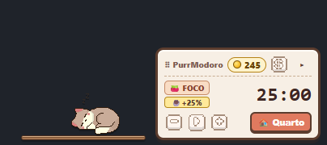
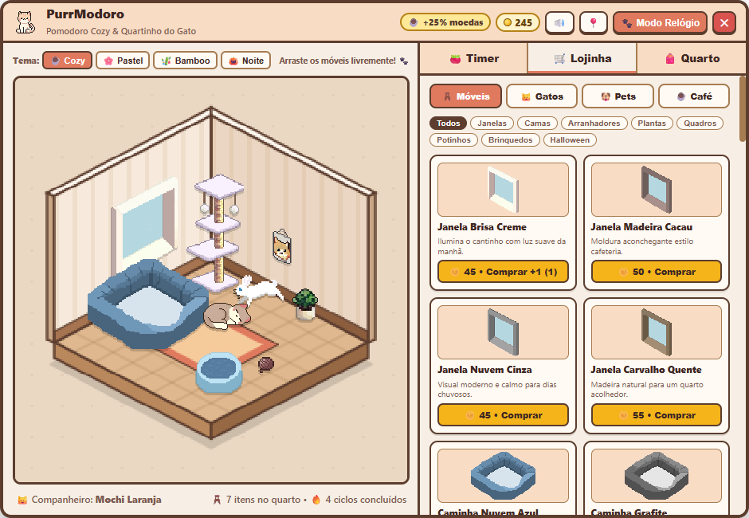

# PurrModoro 🐾🍅

Um **Idle Game + Timer Pomodoro** em pixel art para Windows onde seu gatinho (ou até o **Dino Sem Wi-Fi**!) passeia em uma barrinha discreta perto do relógio enquanto você trabalha. A cada ciclo concluído você ganha moedinhas proporcionais ao tempo da task para desbloquear **móveis isométricos, mesas e prateleiras, temas de quarto, outros gatinhos, chapéuzinhos, amigos pets e comidinhas interativas**, organizando todo o quartinho em **diorama 2:1 com Drag & Drop livre**!

---

## 📥 Download & Instalação (Windows)

### Opção 1 — Executável `.exe` Pronto — v0.1 Beta (`v0.1.0-beta`)

Baixe e execute direto no Windows sem precisar de Node.js pela página de [GitHub Releases](https://github.com/ruishalm/PurrModoro/releases):

- **[📦 Baixar Instalador (`PurrModoro-Setup.exe`)](https://github.com/ruishalm/PurrModoro/releases/latest/download/PurrModoro-Setup.exe)** — assistente de instalação com criação de atalhos na Área de Trabalho e no Menu Iniciar.
- **[🐾 Baixar Versão Portátil (`PurrModoro-Portable.exe`)](https://github.com/ruishalm/PurrModoro/releases/latest/download/PurrModoro-Portable.exe)** — executável único, basta baixar e abrir sem instalar.

> **Aviso do Windows SmartScreen**: por ser um projeto indie sem certificado pago de código, o Windows pode exibir *"O Windows protegeu o computador"*. Clique em **"Mais informações" → "Executar assim mesmo"**.

### Opção 2 — Rodar ou Gerar o `.exe` pelo Código-Fonte

Requer [Node.js](https://nodejs.org/) (v18+).

```bash
git clone https://github.com/ruishalm/PurrModoro.git
cd PurrModoro
```

- **Instalação com 1 Clique (`install_purrmodoro.bat`)**:
  - Instala automaticamente o Electron (se necessário).
  - Reseta qualquer progresso de testes anterior para uma **instalação limpa** (`100` moedinhas iniciais, **Mochi** + **Dino Sem Wi-Fi** e itens iniciais).
  - Cria atalhos com o ícone do gatinho na **Área de Trabalho**, **Menu Iniciar** e **Inicializar com o Windows (`Startup`)**, abrindo direto perto do relógio sem janela preta de prompt.
  - Para remover os atalhos depois (mantendo seu progresso atual salvo em `AppData`), rode **`uninstall_purrmodoro.bat`**.
- **Via Terminal (`npm`)**:
  ```bash
  # Instalar dependências
  npm install

  # Abrir o PurrModoro perto do relógio do Windows
  npm start

  # (Opcional) Reprocessar sprites a partir de Assets/
  npm run prepare-assets

  # Gerar PurrModoro-Setup.exe e PurrModoro-Portable.exe localmente em dist/
  npm run dist
  ```

> **Sem janela de CMD**: para abrir direto quando quiser via código-fonte, use os atalhos criados ou **`start_purrmodoro.bat`**.

> **Ícone na Bandeja (System Tray) & Botão Fechar (`✕`)**: ao clicar no **`✕`** para fechar, o PurrModoro **recolhe para a bandeja do sistema** mantendo o timer ativo. Clique com o botão esquerdo no ícone perto do relógio para reabrir, ou com o botão direito para pausar o timer, alternar **Sempre no Topo**, ativar/desativar **Iniciar com o Windows** (já ativo por padrão) ou encerrar de vez (`🚪 Sair do PurrModoro`).

---

## 📸 Screenshots

<table>
  <tr>
    <td align="center" width="50%">
      <strong>Modo Relógio + HUD Compacto</strong><br /><br />
      
    </td>
    <td align="center" width="50%">
      <strong>Modo Recolhido (Só o Gatinho + Pílula)</strong><br /><br />
      
    </td>
  </tr>
  <tr>
    <td align="center" width="50%">
      <strong>Quartinho Isométrico 2:1 & Lojinha (Tema Cozy)</strong><br /><br />
      
    </td>
    <td align="center" width="50%">
      <strong>Timer Regulável & Tema Noite (Halloween)</strong><br /><br />
      
    </td>
  </tr>
</table>

---

## ✨ Funcionalidades

- **Modo Relógio (Transparente, Fino & Colapsável)**:
  - Widget com fundo 100% transparente ancorado acima do relógio do Windows (`alwaysOnTop`).
  - Barrinha de apoio super fina (`6px`) para o gatinho parecer estar andando direto sobre a barra de tarefas.
  - Botão **`▸` Recolher**: esconde o card do timer e deixa praticamente **só o gatinho** na tela junto de uma micro-pílula discreta (`◂` expandir, relógio, Play/Pause e `🏠` Quarto).
  - Clicar no gatinho faz carinho nele com partículas de coração, ronronar e falinhas fofas.
- **Quartinho Isométrico 2:1 (10×10) com Superfícies & Drag & Drop Livre**:
  - Diorama isométrico expandido desenhado sob medida para combinar perfeitamente com os sprites isométricos da coleção.
  - **Mesas & Prateleiras com Superfície Real**: arraste potinhos, plantinhas, luminárias e petiscos para cima de mesas e da prateleira de parede — tudo se move junto e respeita a profundidade (Z-order) automaticamente!
  - Janelas e quadros identificam automaticamente a **Parede Esquerda** e a **Parede Direita**, espelhando a perspectiva isométrica sozinhos ao arrastar de um lado para o outro!
  - Barra flutuante para espelhar (`↔`), ajustar profundidade (`⬆ / ⬇`) e guardar no inventário (`📦`), além de **4 temas desbloqueáveis por moedas** (*Cozy* inicial, *Pastel*, *Jardim Bamboo* e *Noite Mística*).
- **Timer Pomodoro 100% Regulável & Recompensa por Tempo de Task**:
  - Regule livremente **Foco (1–180 min)**, **Pausa Curta (1–60 min)**, **Pausa Longa (1–90 min)** e **Ciclos/Longa (2–8)** — tudo salvo automaticamente!
  - Presets rápidos (*Clássico 25/5*, *Sprint 15/3*, *Deep 50/10*, *Leve 20/5*) e botões **`-5m / -1m / +1m / +5m`** ao vivo.
  - Se concluir o foco, o gatinho comemora com chuva de moedas; se desistir no meio, ele chora 😿.
- **Lojinha Completa (5 Categorias • 77 Itens + Temas)**:
  - **🛋️ Móveis & Decor (42 itens)**: móveis isométricos, superfícies, potinhos, luminárias e objetos animados.
  - **🐱 Gatinhos & Companheiros (10 skins)**: 9 gatinhos fofos + o clássico **Dino Sem Wi-Fi** em pixel art completo!
  - **🎩 Chapéus (10 acessórios)**: coroa, chapéu de mago, cartola, chapéu mestre cuca, headphone lo-fi, boina e mais — aparecem no **Modo Relógio**, no **Quarto** e na **Loja**.
  - **🐾 Amigos Pets (3 pets)**: *Coelhinho*, *Golden Retriever* e *Mãozinha Zumbi* andando pelo quarto.
  - **☕ Café & Comidinhas Interativas (12 itens)**:
    - Ao clicar em **Pegar**, a comidinha **gruda no cursor**: entregue direto **na boquinha** do gatinho/pet, coloque em cima de um **potinho ou mesa**, ou deixe **no chão** para eles irem andando comer sozinhos!
    - Bebidas com bônus de moedas (*Café Latte `+25%`*, *Bubble Tea de Taro `+35%`*, *Matcha Latte `+40%`* e *Cafeteira Moka `+50%`*) multiplicam a recompensa do próximo foco concluído.

### 🪙 Ganho de Moedas por Tempo de Task

A recompensa escala diretamente com a duração da sua task:

| Fase | Regra Base | Bônus de Duração Longa | Exemplos |
| :--- | :--- | :--- | :--- |
| **🍅 Foco** | **2 moedas / min** | `+20%` em tasks **≥ 25 min** • `+40%` em tasks **≥ 45 min** | `5m = 10` • `15m = 30` • `20m = 40` • `25m = 55` • `50m = 120` 🪙 |
| **☕ Pausa Curta** | **1 moeda / min** | — | `3m = 3` • `5m = 5` • `10m = 10` 🪙 |
| **🌙 Pausa Longa** | **~1.2x min** | — | `10m = 12` • `15m = 18` • `20m = 24` 🪙 |

> Bônus de café (*Latte `+25%`* / *Moka `+50%`*) multiplicam o valor total do próximo foco concluído!

---

## 📖 Documentação

Confira os detalhes de design, projeção isométrica 2:1 e pipeline de assets em [docs/PURRMODORO_DESIGN.md](docs/PURRMODORO_DESIGN.md).
