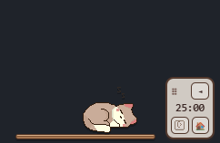
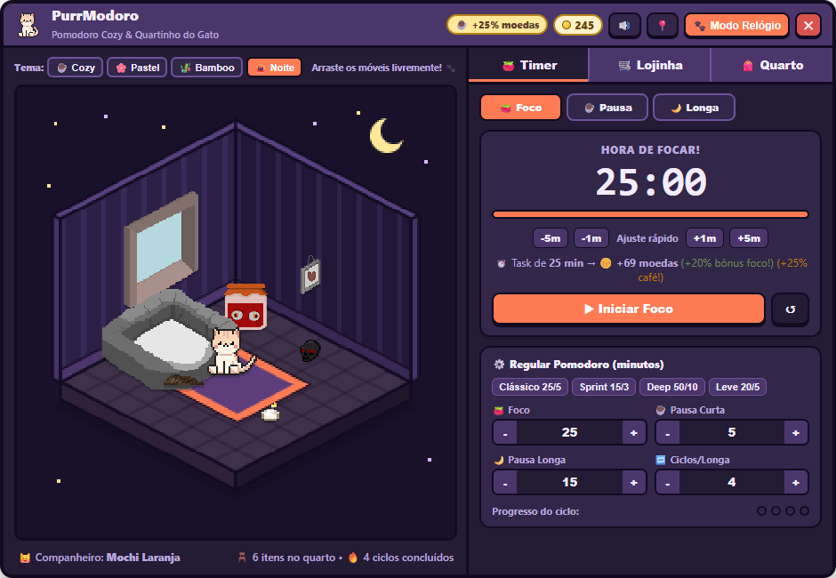

# PurrModoro 🐾🍅

Um **Idle Game + Timer Pomodoro** em pixel art para Windows onde um gatinho fofo passeia em uma barrinha discreta perto do relógio enquanto você trabalha. A cada ciclo concluído você ganha moedinhas proporcionais ao tempo da task para desbloquear **móveis isométricos, decorações, outros gatinhos, amigos pets e cafézinhos**, organizando todo o quartinho em **diorama 2:1 com Drag & Drop livre**!

---

## 📸 Screenshots

<table>
  <tr>
    <td align="center" width="50%">
      <strong>Modo Relógio + HUD Compacto</strong><br /><br />
      
    </td>
    <td align="center" width="50%">
      <strong>Modo Recolhido (Só o Gatinho + Pílula)</strong><br /><br />
      
    </td>
  </tr>
  <tr>
    <td align="center" width="50%">
      <strong>Quartinho Isométrico 2:1 & Lojinha (Tema Cozy)</strong><br /><br />
      
    </td>
    <td align="center" width="50%">
      <strong>Timer Regulável & Tema Noite (Halloween)</strong><br /><br />
      
    </td>
  </tr>
</table>

---

## ✨ Funcionalidades

- **Modo Relógio (Transparente, Fino & Colapsável)**:
  - Widget com fundo 100% transparente ancorado acima do relógio do Windows (`alwaysOnTop`).
  - Barrinha de apoio super fina (`6px`) para o gatinho parecer estar andando direto sobre a barra de tarefas.
  - Botão **`▸` Recolher**: esconde o card do timer e deixa praticamente **só o gatinho** na tela junto de uma micro-pílula discreta (`◂` expandir, relógio, Play/Pause e `🏠` Quarto).
  - Clicar no gatinho faz carinho nele com partículas de coração, ronronar e falinhas fofas.
- **Quartinho Isométrico 2:1 com Drag & Drop Livre**:
  - Diorama isométrico desenhado sob medida para combinar perfeitamente com os sprites isométricos da coleção.
  - Janelas e quadros identificam automaticamente a **Parede Esquerda** e a **Parede Direita**, espelhando a perspectiva isométrica sozinhos ao arrastar de um lado para o outro!
  - Barra flutuante para espelhar (`↔`), ajustar profundidade (`⬆ / ⬇`) e guardar no inventário (`📦`), além de **4 temas visuais** (*Cozy*, *Pastel*, *Bamboo* e *Noite*).
- **Timer Pomodoro 100% Regulável & Recompensa por Tempo de Task**:
  - Regule livremente **Foco (1–180 min)**, **Pausa Curta (1–60 min)**, **Pausa Longa (1–90 min)** e **Ciclos/Longa (2–8)** — tudo salvo automaticamente!
  - Presets rápidos (*Clássico 25/5*, *Sprint 15/3*, *Deep 50/10*, *Leve 20/5*) e botões **`-5m / -1m / +1m / +5m`** ao vivo.
  - Se concluir o foco, o gatinho comemora com chuva de moedas; se desistir no meio, ele chora 😿.
- **Lojinha Completa (4 Categorias)**:
  - **Móveis & Decor**, **9 Gatinhos/Skins**, **Amigos Pets** (*Coelhinho*, *Golden Retriever* e *Mãozinha Zumbi*) e **Café & Comidinhas** (*Café Latte `+25%`* e *Cafeteira Moka `+50%`*).

### 🪙 Ganho de Moedas por Tempo de Task

A recompensa escala diretamente com a duração da sua task:

| Fase | Regra Base | Bônus de Duração Longa | Exemplos |
| :--- | :--- | :--- | :--- |
| **🍅 Foco** | **2 moedas / min** | `+20%` em tasks **≥ 25 min** • `+40%` em tasks **≥ 45 min** | `5m = 10` • `15m = 30` • `20m = 40` • `25m = 55` • `50m = 120` 🪙 |
| **☕ Pausa Curta** | **1 moeda / min** | — | `3m = 3` • `5m = 5` • `10m = 10` 🪙 |
| **🌙 Pausa Longa** | **~1.2x min** | — | `10m = 12` • `15m = 18` • `20m = 24` 🪙 |

> Bônus de café (*Latte `+25%`* / *Moka `+50%`*) multiplicam o valor total do próximo foco concluído!

---

## 📦 Instalador Simples (Windows)

### Pré-requisitos
- [Node.js](https://nodejs.org/) (v18+)

### Opção A — Instalação com 1 Clique (Recomendado)
1. Clone ou baixe este repositório:
   ```bash
   git clone https://github.com/ruishalm/PurrModoro.git
   cd PurrModoro
   ```
2. Dê duplo-clique em **`install_purrmodoro.bat`** (ou rode no terminal):
   - Instala automaticamente o Electron (se ainda não estiver instalado).
   - Cria o atalho **`PurrModoro`** com o ícone do gatinho na sua **Área de Trabalho** e no **Menu Iniciar**.
   - Abre o PurrModoro perto do relógio sem deixar janela preta de prompt aberta.

Para remover os atalhos depois (mantendo seu progresso salvo em `AppData`), basta rodar **`uninstall_purrmodoro.bat`**.

### Opção B — Via Terminal (`npm`)
```bash
# Instalar dependências
npm install

# Abrir o PurrModoro perto do relógio do Windows
npm start

# (Opcional) Reprocessar sprites a partir de Assets/
npm run prepare-assets

# (Opcional) Gerar instalador/portátil .exe em dist/ (requer electron-builder)
npm install -D electron-builder && npm run dist
```

> **Sem janela de CMD**: Para abrir direto quando quiser, use os atalhos criados ou **`start_purrmodoro.bat`**.

> **Ícone na Bandeja (System Tray)**: O PurrModoro também fica na bandeja ao lado do relógio. Clique com o botão direito nele para alternar entre Modo Relógio / Quartinho, pausar o timer ou ligar/desligar *Sempre no Topo*.

---

## 📖 Documentação

Confira os detalhes de design, projeção isométrica 2:1 e pipeline de assets em [docs/PURRMODORO_DESIGN.md](docs/PURRMODORO_DESIGN.md).
